# Librería Hoja Nueva – Catálogo por categorías

| | |
|---|---|
| **Alumno** | Francisco Parra |
| **Asignatura** | Desarrollo Frontend II (PFY2202) |
| **Actividad** | Formativa 3 – Semana 4: "Utilizando tecnologías de integración entre frontend y backend" |
| **Sitio publicado** | https://fcoxavierparra.github.io/PFY2202_S4_FPARRA/ |
| **Tecnologías** | React 18, React Router 7, MSW 2 (Mock Service Worker), Tailwind CSS 3, Vite 7, Vitest |

Tienda de libros en React donde los usuarios exploran el catálogo por categoría. Las categorías, los libros y el detalle de cada libro se obtienen de una **API REST simulada con MSW**, que funciona tanto en local como en el sitio publicado.

## Recorrido sugerido (3 minutos)

1. Abrir el [sitio](https://fcoxavierparra.github.io/PFY2202_S4_FPARRA/). Las categorías llegan desde `GET /api/categorias`; mientras tanto se ve el indicador de carga.
2. Entrar a **Ciencia Ficción** y luego a un libro. Cada pantalla consume su propio endpoint.
3. Volver a una categoría ya visitada: aparece al instante, sin indicador, porque la respuesta se reutiliza.
4. Abrir el **🧪 Panel de pruebas de la API**, al pie de la página, y elegir **Error del servidor**. Pulsar **Vaciar caché** y entrar a otra categoría: se ven los reintentos automáticos y luego un mensaje con **Reintentar**. Volver a **Normal** y presionar **Reintentar** recupera la página.
5. Elegir **Sin conexión** y recargar con F5. Las categorías siguen visibles, con un aviso de que son datos guardados.
6. Abrir [`/categorias/terror`](https://fcoxavierparra.github.io/PFY2202_S4_FPARRA/categorias/terror), que responde 404, y [`/categorias/poesia`](https://fcoxavierparra.github.io/PFY2202_S4_FPARRA/categorias/poesia), una categoría sin libros.

> El escenario elegido en el panel dura mientras la pestaña esté abierta. Para volver al comportamiento normal, elige **Normal**.

---

## Cumplimiento de la pauta

### 1. Creación e integración de un mock REST

La API se simula con **MSW 2**, igual que en la guía de la semana. MSW intercepta en el navegador las peticiones a `/api` y responde con JSON y códigos HTTP, como lo haría un backend real.

| Endpoint | Respuesta | Errores |
|---|---|---|
| `GET /api/categorias` | Categorías con su cantidad de libros | — |
| `GET /api/categorias/:slug/libros` | Categoría y sus libros (sin sinopsis) | **404** si la categoría no existe |
| `GET /api/libros/:id` | Detalle del libro, con sinopsis | **404** si el libro no existe |

- **Handlers:** [src/mocks/handlers.js](src/mocks/handlers.js), con datos en [src/mocks/datos.js](src/mocks/datos.js).
- **Service Worker:** [src/mocks/browser.js](src/mocks/browser.js) y `public/mockServiceWorker.js`.
- **Activación:** [src/main.jsx](src/main.jsx) activa el mock **antes** de mostrar la aplicación, para que ninguna petición salga sin respuesta. A diferencia del ejemplo de la guía, que solo lo activa en desarrollo, aquí también se activa en producción, porque GitHub Pages no tiene un backend real.
- **Separación de responsabilidades:** los componentes nunca leen los datos directamente; siempre pasan por la API mediante `fetch`. Basta con cambiar la URL para conectar un backend real.

| Categorías (`/api/categorias`) | Libros de una categoría | Detalle de un libro |
|---|---|---|
| 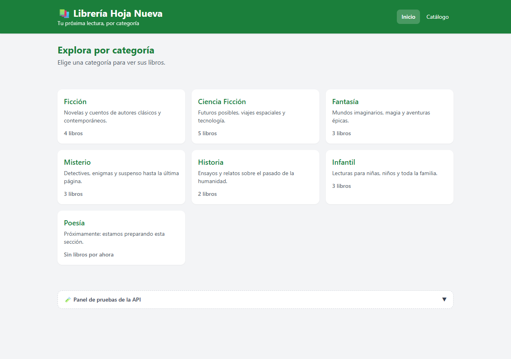 | 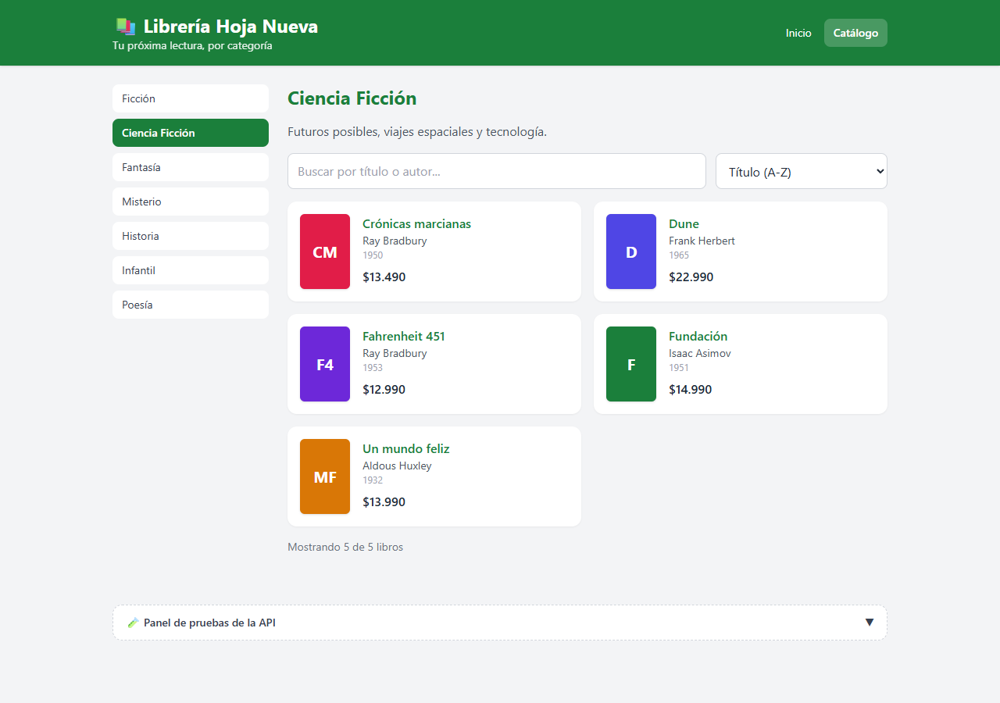 | 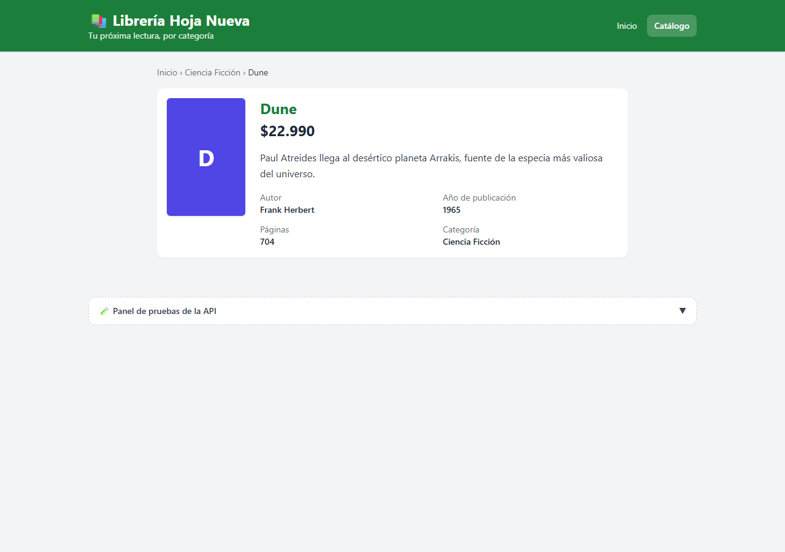 |

### 2. Manejo de errores en las peticiones

El cliente HTTP ([src/api/cliente.js](src/api/cliente.js)) convierte cada falla en un error con un **tipo concreto**. Cada tipo tiene su propio mensaje y su propia **salida alternativa** ([src/components/MensajeError.jsx](src/components/MensajeError.jsx)):

| Falla | Mensaje al usuario | Alternativa ofrecida |
|---|---|---|
| **404** categoría o libro inexistente | El mensaje del servidor, por ejemplo *La categoría "terror" no existe* | Enlace a todas las categorías o al inicio (no se ofrece reintentar, porque no se arreglaría) |
| **500** error del servidor | *El servidor no está disponible… Lo intentamos 3 veces* | **Reintento automático** (2 veces, con espera creciente) y luego botón **Reintentar** |
| **Sin conexión** | *Sin conexión con el servidor. Revisa tu conexión…* | Reintento automático, botón **Reintentar** y **datos guardados** si existen |
| **Tiempo agotado** (más de 8 s) | *El servidor está tardando demasiado* | Reintento automático y botón **Reintentar** |
| Falla con **datos guardados** | Aviso: *te mostramos la última información guardada* | La página sigue usable, con **Reintentar** en el aviso |
| Categoría **vacía** | *Aún no hay libros en esta categoría* | Botón **Explorar otras categorías** |

| Reintento automático en curso | Error 500 tras los reintentos | Sin conexión: datos guardados |
|---|---|---|
| 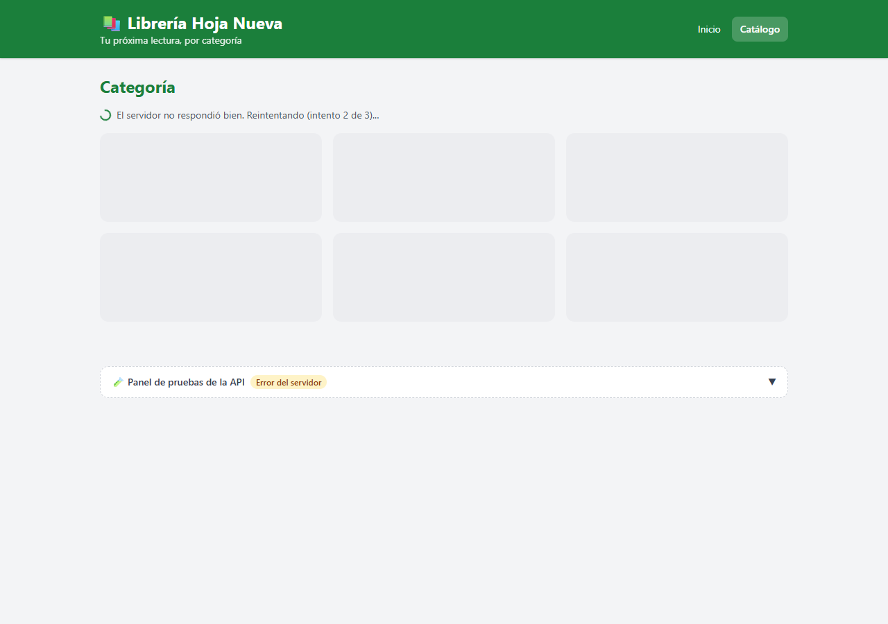 | 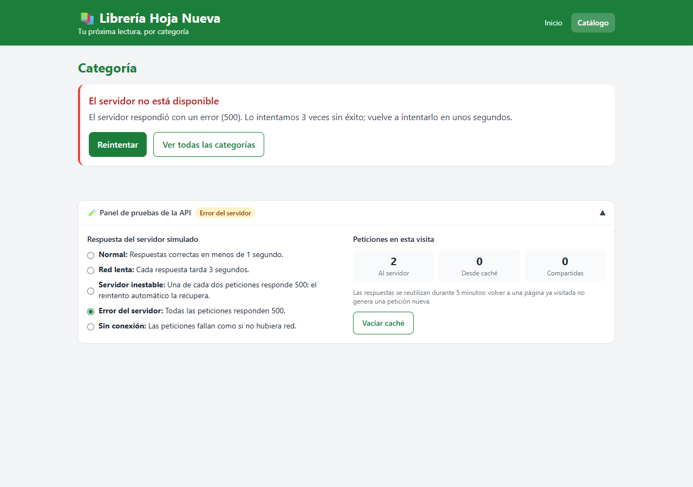 | 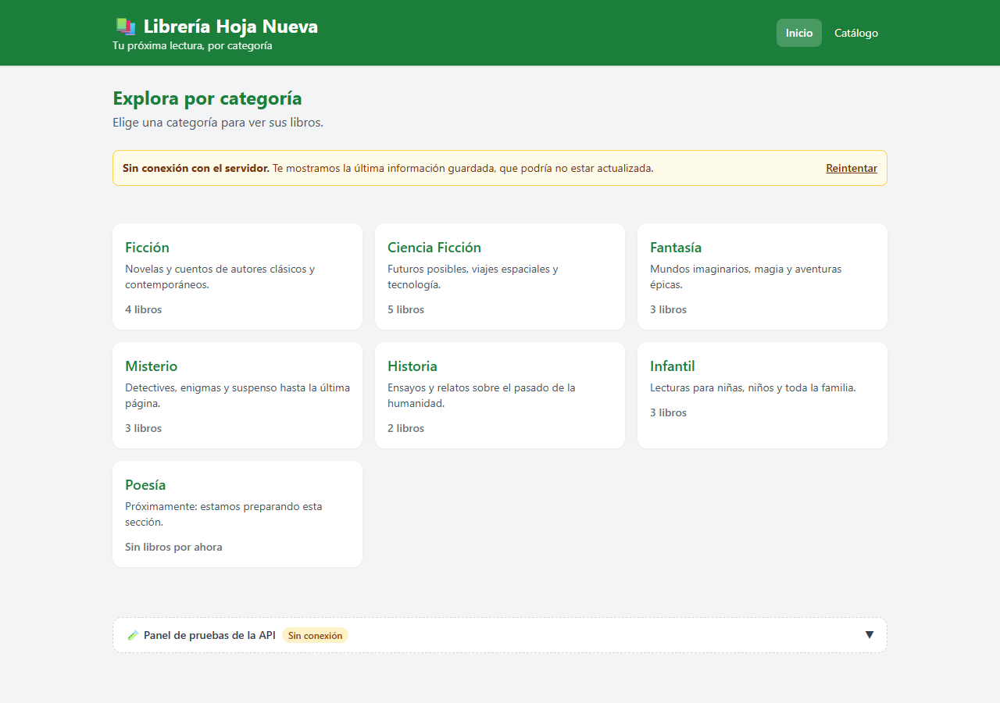 |

| Categoría inexistente (404) | Categoría vacía |
|---|---|
| 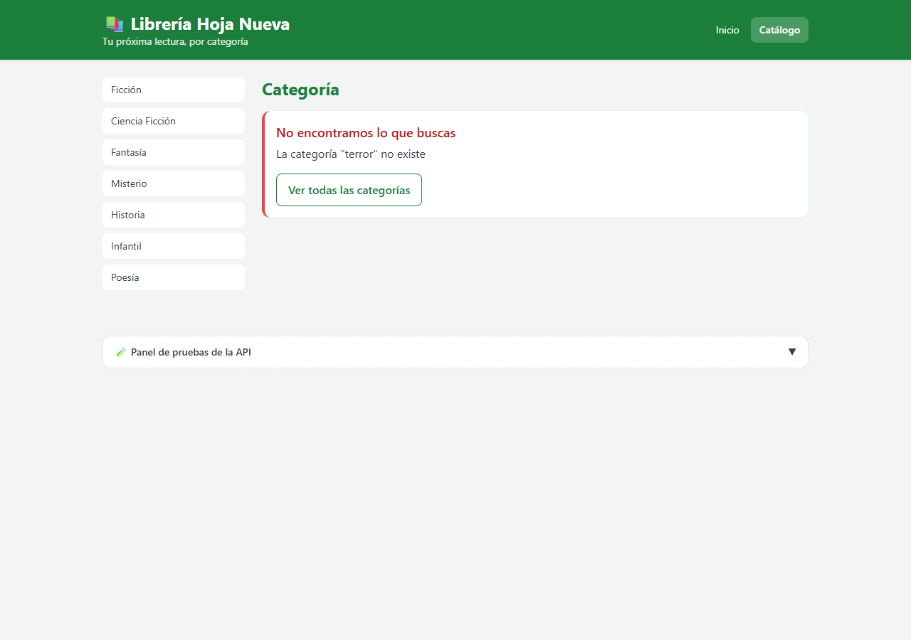 | 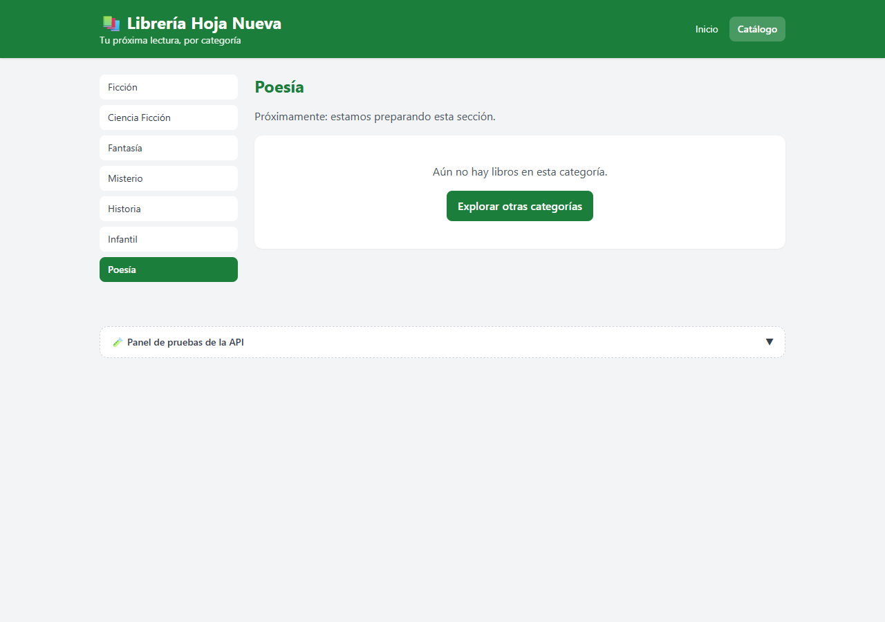 |

### 3. Control de carga y estado de las peticiones

Cada pantalla consume la API con el hook [useConsulta](src/hooks/useConsulta.js), que expone el estado de **cada petición**: `cargando`, `actualizando`, `intento`, `error` y `datos`.

- **Primera carga:** [EstadoCarga](src/components/EstadoCarga.jsx) muestra un texto ("Cargando categorías…", "Cargando libros…") y bloques de relleno con la forma del contenido, así la página no salta al llegar los datos. Se retira apenas llega la respuesta o el error.
- **Reintentos visibles:** el indicador cambia a *"El servidor no respondió bien. Reintentando (intento 2 de 3)…"*.
- **Actualización sin interrupción:** si hay datos guardados, se muestran de inmediato y un aviso discreto *"Actualizando…"* indica que se está pidiendo la versión nueva. Así el usuario nunca queda frente a una pantalla vacía.
- **Accesibilidad:** los indicadores usan `role="status"` y `aria-busy`, y los errores usan `role="alert"`.

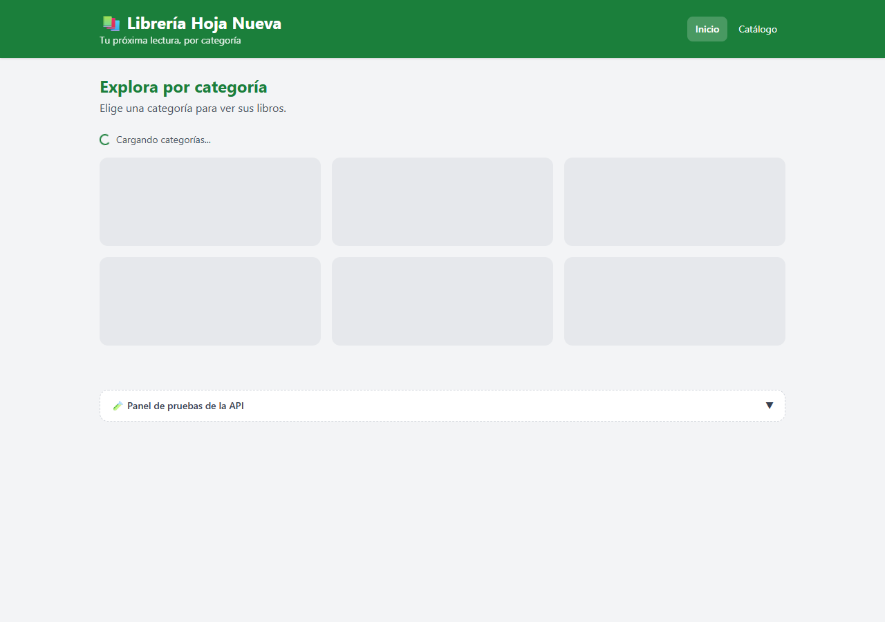

### 4. Optimización y eficiencia en la consulta de datos

La caché ([src/api/cache.js](src/api/cache.js)) evita peticiones repetidas o innecesarias:

| Técnica | Efecto |
|---|---|
| **Reutilización por 5 minutos** | Volver a una página ya visitada no genera una petición nueva |
| **Peticiones compartidas** | Si dos componentes piden lo mismo a la vez, se hace una sola petición |
| **Datos compartidos entre vistas** | El menú lateral de categorías reutiliza la respuesta del inicio, sin otra petición |
| **Búsqueda y orden locales** | Filtrar por título o autor y ordenar por precio o año se hace sobre los datos ya recibidos |
| **Carga solo de lo necesario** | El listado no trae la sinopsis; se pide solo al abrir el detalle |
| **Precarga por intención** | Al pasar el mouse o enfocar una categoría o un libro, sus datos se piden por adelantado y la página abre al instante |
| **Respuestas obsoletas descartadas** | Si el usuario cambia de categoría antes de que llegue la respuesta anterior, esa respuesta se ignora |
| **Páginas bajo demanda** | Cada página se descarga recién al visitarla (`React.lazy`) |

El **panel de pruebas** cuenta en vivo las peticiones que llegaron al servidor, las que se respondieron desde la caché y las que se compartieron:

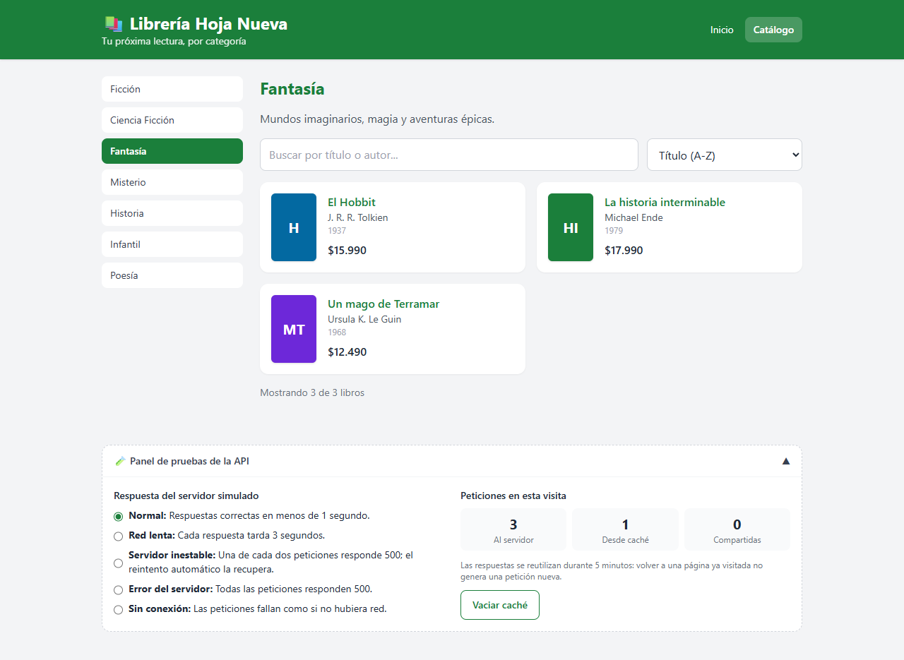

---

## Navegación (React Router 7)

| Ruta | Página | Petición |
|---|---|---|
| `/` | Inicio: categorías | `GET /api/categorias` |
| `/categorias/:slug` | Libros de la categoría, con búsqueda, orden y menú de categorías | `GET /api/categorias/:slug/libros` |
| `/libros/:id` | Detalle del libro, con ruta de navegación (Inicio › Categoría › Libro) | `GET /api/libros/:id` |
| `*` | Página 404 | — |

Las rutas están centralizadas en [src/routes/AppRoutes.jsx](src/routes/AppRoutes.jsx), con un [Layout](src/layouts/Layout.jsx) común (`<Outlet />`). Los menús usan `NavLink` y marcan la sección activa.

| Celular |
|---|
| 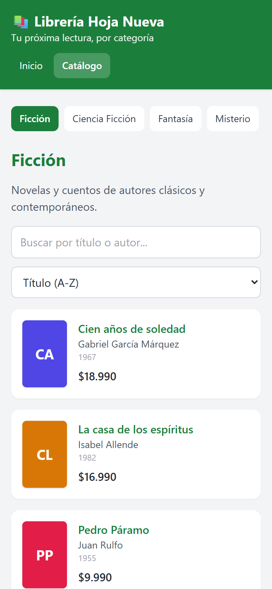 |

## Flujo de una petición

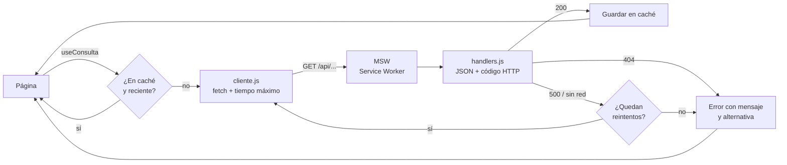

## Pruebas automatizadas

`npm test` ejecuta **23 pruebas** con Vitest y Testing Library. Usan los **mismos handlers de MSW** del sitio, ejecutados en Node (`msw/node`). También corren en cada publicación: si alguna falla, el sitio no se publica.

| Archivo | Qué verifica |
|---|---|
| [api.test.js](src/test/api.test.js) | Respuestas de los 3 endpoints; errores 404 (sin reintentos), 500 (3 intentos), sin conexión, tiempo agotado y otros códigos; servidor inestable recuperado por el reintento; caché, peticiones compartidas y datos guardados ante fallas |
| [App.test.jsx](src/test/App.test.jsx) | Indicador de carga que aparece y se retira; navegación inicio → categoría → libro; búsqueda y orden sin peticiones nuevas; páginas ya visitadas sin petición repetida; categoría vacía e inexistente; error 500 con reintento manual; datos guardados sin conexión; 404 de libro y de ruta |

## Estructura

```
├── index.html                   Página base (entrada de Vite)
├── vite.config.js               Vite: plugin de React, ruta base y pruebas
├── public/mockServiceWorker.js  Service Worker de MSW (generado con "npx msw init")
└── src/
    ├── main.jsx                 Activa el mock y monta la aplicación
    ├── routes/AppRoutes.jsx     Rutas y carga diferida de páginas
    ├── layouts/Layout.jsx       Cabecera, menú, <Outlet /> y panel de pruebas
    ├── mocks/                   Backend simulado: handlers, datos, escenarios, worker
    ├── api/
    │   ├── cliente.js           fetch, tiempo máximo, tipos de error y reintentos
    │   ├── cache.js             Caché, peticiones compartidas y contadores
    │   └── libreria.js          Consultas de la librería y precarga
    ├── hooks/useConsulta.js     Estado de cada petición para los componentes
    ├── components/              EstadoCarga, MensajeError, PanelPruebas, tarjetas, portada
    │   └── ui/                  Boton, Aviso
    ├── pages/                   Inicio, Categoria, DetalleLibro, NoEncontrado
    └── test/                    Pruebas automatizadas
```

## Ejecución local

Requiere Node.js 24.

```bash
git clone https://github.com/FcoXavierParra/PFY2202_S4_FPARRA.git
cd PFY2202_S4_FPARRA
npm install
npm run dev     # http://localhost:5173 (el mock se activa solo)
npm test        # pruebas automatizadas
npm run build   # versión de producción en dist/
```
